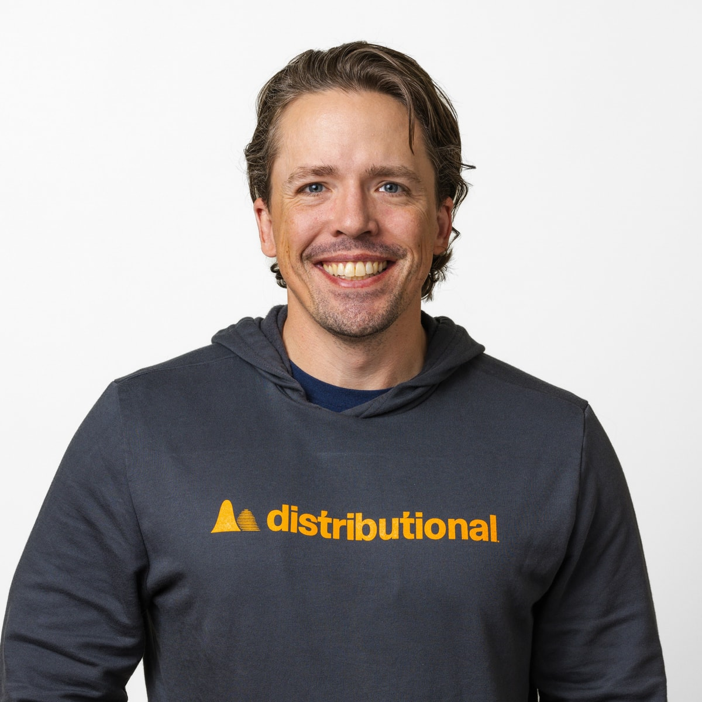

---
---
# Guest Lecture: Scott Clark

**Mon, Nov 9, 9:05--9:55am**, Upson Hall 222. The usual [Zoom link](syllabus.html#zoom) is available for Cornell Tech students.

## Accelerating Science with AI: Surfing the Frontier Between the Bitter Lesson and No Free Lunch

**Scott Clark**, Co-founder and CEO, Distributional (building Talaria Scientific)

### Abstract

Abundance through AI means new science: better materials, cheaper energy, better simulators for the fluids inside almost everything that moves, burns, or cools. Two famous ideas argue for opposite ways of getting there. The bitter lesson says general methods that scale with compute beat clever, hand-built ones. The no-free-lunch theorem says no method beats the rest unless its assumptions match the problem in front of it. Both are right: each AI model generation raises the bar and submerges more of what specialists built, but the wave rises in-distribution, where the data is. Past the edge of what any model has been validated on is where research lives and will continue to live as the frontier evolves. In this talk I will walk through how harnessing these new AI models can help scientists solve novel problems faster than ever before. I will walk through how better AI harnesses can help accelerate the work of creating new physics surrogate models, how Bayesian optimization can help select the right model for a given job, and the impact this will have on world models and the search for new materials, drugs, and more.

The pace of science is set by validation. Ideas move science forward, but testing them is often expensive in terms of researcher time. Agents are now good at the mechanical middle of research: the undifferentiated work of spinning up environments, running experiments, debugging code, etc. Better AI models can help attack this in-distribution problem, freeing up researchers to focus on novel out-of-distribution research on the frontier, but the division of labor needs to be explicitly defined in an agentic harness. Every field that simulates the physical world has kept a sparse portfolio of models, from the full-fidelity solvers it trusts to the cheap approximations it can afford. Learned surrogates using AI methods are filling that portfolio, and a harness that manufactures validated surrogates cheaply makes the Pareto frontier of accuracy versus cost dense enough to unlock new approaches to solving problems. Picking the right model for each job under a budget becomes an optimization problem over a dense set of tradeoffs. Having many models to choose from and an optimizer to make that choice allows us to answer previously unassailable questions in materials discovery and world modeling.

### Bio

Scott Clark is the co-founder and CEO of Distributional, building Talaria Scientific, a multi-agent harness for computational science research that turns a 10x researcher into a 100x researcher, with the scientist in the loop and HPC as the guardrail. He previously co-founded and led SigOpt, a Bayesian optimization company acquired by Intel in 2020, and then served as Intel's VP and GM of AI and HPC Supercomputing. At Yelp he co-created MOE, the first production open-source Bayesian optimization engine. Scott holds a PhD in applied mathematics and an MS in computer science from Cornell University, where he was a Department of Energy Computational Science Graduate Fellow, and three bachelor's degrees, in mathematics, physics, and computational physics, from Oregon State University. He was named to the Forbes 30 Under 30 list in enterprise technology in 2016 and lives in the San Francisco Bay Area.

More: [scottclark.io](https://scottclark.io). A recorded talk of his from Berkeley RDI: [YouTube](https://youtu.be/1VO7hdEgSeo), with a [recap post](https://scottclark.io/blog/better-evals-abundance).

Photo and bio: Talaria Scientific press kit.

